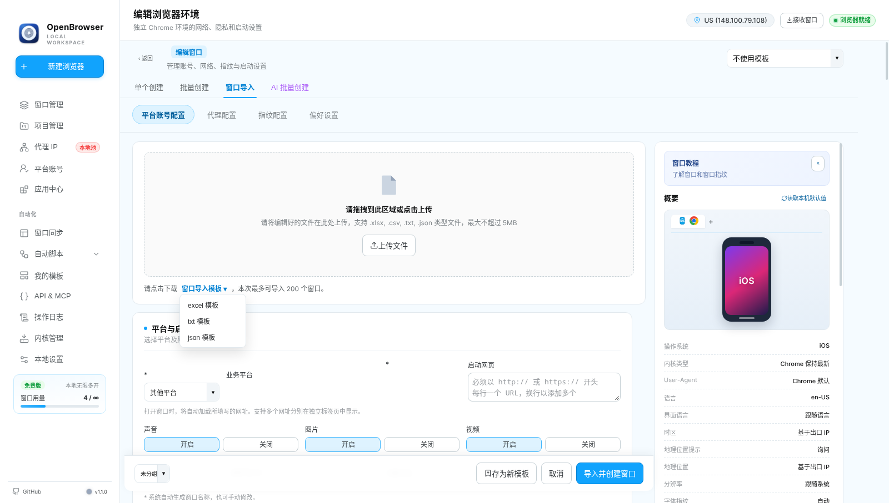
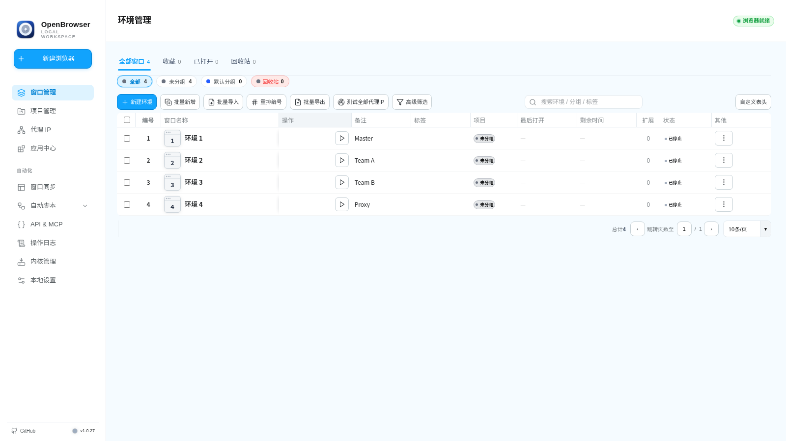
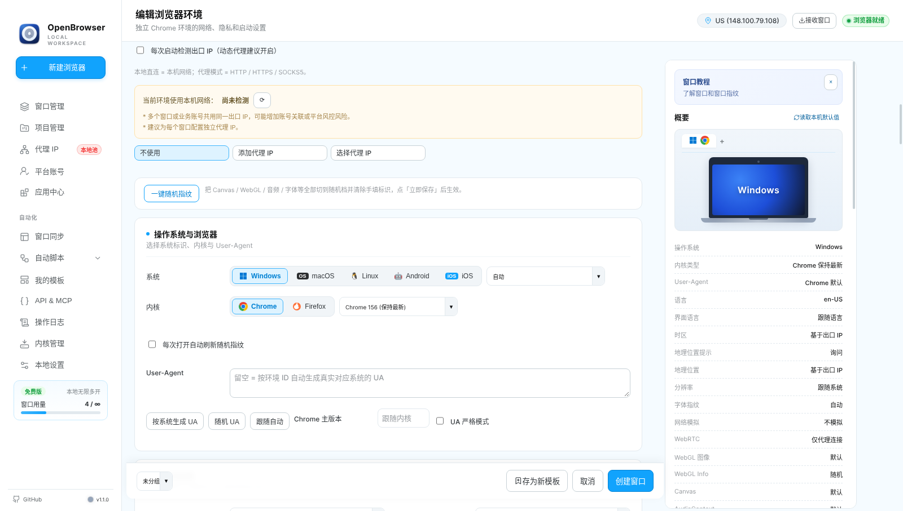
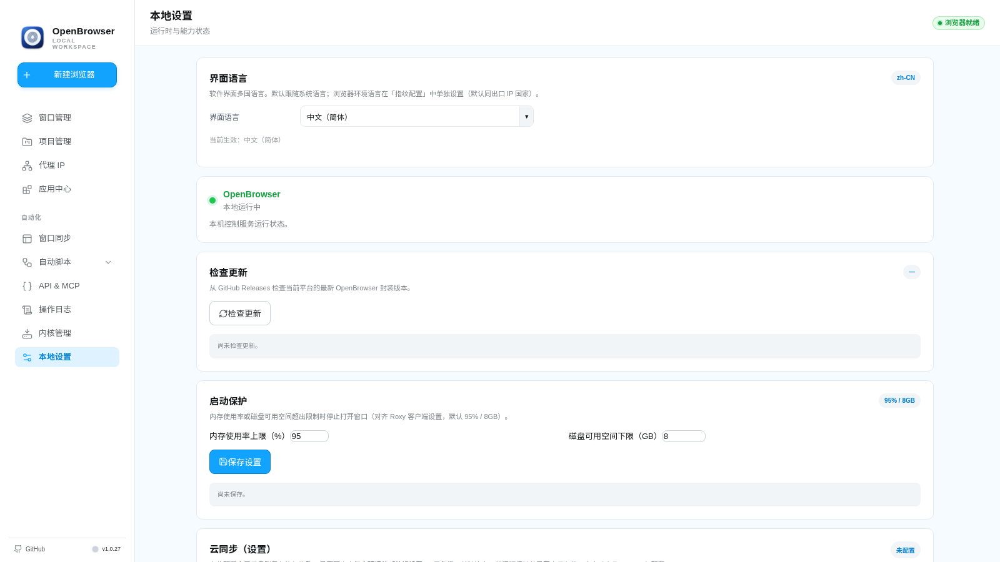

<div align="center">


[](https://github.com/zhu748/OpenBrowser)
[](https://github.com/zhu748/OpenBrowser)
[](./LICENSE)
[](https://nodejs.org/)

**Multi-language support / 多国语言支持**

🇺🇸 **English** · 🇨🇳 [中文](./README_CN.md)

**Local fingerprint browser · Isolated Chromium profiles · Proxy / fingerprint / sync / RPA**

</div>

---

## Overview

OpenBrowser is a local desktop fingerprint browser for managing multiple isolated Chromium environments. It combines profile isolation, proxy configuration, browser fingerprint controls, extension management, window synchronization, a local API, MCP integration, and local RPA workflows in one desktop app.

The app supports multiple UI languages, currently including English and Chinese.

> Read the [disclaimer](./DISCLAIMER.md) before use. OpenBrowser does not guarantee anonymity, unique fingerprints, or compatibility with any specific website.

## Contents

- [Screenshots](#screenshots)
- [Key features](#key-features)
- [Supported platforms](#supported-platforms)
- [Quick start](#quick-start)
- [Packaging](#packaging)
- [Self-tests](#self-tests)
- [Project layout](#project-layout)
- [Data and security](#data-and-security)

## Screenshots

| Overview | Environments |
| :---: | :---: |
|  |  |
| Main navigation and module entry points | Profiles, start/stop controls, and groups |

| Profile / fingerprint | Local settings |
| :---: | :---: |
|  |  |
| Proxy, fingerprint, and extension settings | Theme, language, and system options |

## Key features

| Area | What it provides |
| --- | --- |
| **Profile isolation** | Separate Chromium profiles so cookies, cache, and storage do not mix. |
| **Batch management** | Groups, tags, bulk start/stop, logs, and window sizing. |
| **Proxy support** | HTTP / HTTPS / SOCKS proxies per environment, with egress checks. |
| **Fingerprint controls** | Platform, language, timezone, user agent, Canvas, WebGL, WebRTC, and more. |
| **Extension center** | Built-in, recommended, and local extensions loaded per environment. |
| **Window sync** | CDP-based synchronization for clicks, scrolling, input, and tabs. |
| **Local RPA** | Flows for navigation, waiting, clicking, typing, and screenshots. |
| **Local API / MCP** | Local integration endpoint on `127.0.0.1:50325` by default. |
| **Independent kernel** | Download a standalone Chromium kernel or use a custom local path. |
| **Multi-version kernels** | One kernel per major release, like mainstream fingerprint browsers: Chrome for Testing offers its latest build for every major (145/146/147…, under `kernels/chromium-versions/<version>`), and official Firefox releases cover every generation (`kernels/firefox/<version>`, tarball / DMG / MSI per platform, SHA-256 verified from Mozilla's SHA256SUMS). Any installed version can be pinned as the default kernel. |
| **Firefox engine** | Per-profile engine choice (Chromium or Firefox). Firefox environments launch with UA / language / proxy / telemetry prefs applied via `user.js`, no CDP required. RPA and window sync stay Chromium-only by design. |
| **Extension install** | Install extensions inside the browser itself — Chrome Web Store "Add to Chrome" or Firefox add-ons — and the install persists in the profile across restarts (no blocking launch switches, profile prep merges `Preferences` instead of clobbering, retention/cache cleanup never touches `Default/Extensions`). The App Center adds batch install (built-in apps, one-click store imports, local folders) with per-profile enable/disable via `--load-extension`. |
| **Backup options** | Local, WebDAV, GitHub, and cloud-drive backups when explicitly enabled. |

## Supported platforms

| Platform | Architecture | Status |
| --- | --- | --- |
| Windows | x86_64 | ✅ Supported |
| macOS | x86_64 | ✅ Supported |
| macOS | arm64 | ✅ Supported |
| Ubuntu | x86_64 | ✅ Supported |

## Quick start

Requires Node.js LTS and npm.

```bash
cd Browserapp
npm ci --include=dev
npm run selftest -- environment   # quick smoke check (one registered test)
npm start
```

Or use the launcher scripts from the repository root:

| Platform | Launcher |
| --- | --- |
| macOS | [`start-test.command`](./start-test.command) |
| Windows | [`start-test.cmd`](./start-test.cmd) |
| Ubuntu | [`start-test.sh`](./start-test.sh) |

## Packaging

```bash
cd Browserapp
# Optional: OPENBROWSER_PACKAGE_ARCH=x86_64 or arm64
npm run build:rustcore
npm run package:portable
```

Build output is written to `Browserapp/dist/`.

| Platform | Output notes |
| --- | --- |
| Windows | Includes `START.cmd`. |
| macOS | Includes `OpenBrowser.app` and `启动.command`. |
| Ubuntu x86_64 | Includes an `OpenBrowser-…tar.gz` portable archive and launcher. |

Installers do not contain a browser kernel. Download the independent Chrome Stable kernel in the application after installation. Run the Linux package as a normal desktop user, not with `sudo`.
If required, install the standard Electron/Chromium desktop libraries:

```bash
sudo apt-get install libatk-bridge2.0-0 libatk1.0-0 libatspi2.0-0 libcups2 libdrm2 libgbm1 libglib2.0-0 libgtk-3-0 libnspr4 libnss3 libxcomposite1 libxdamage1 libxfixes3 libxkbcommon0 libxrandr2
```

## Self-tests

The SUITE registry in `Browserapp/scripts/selftest-all.js` is the single list of
registered tests; `npm run selftest -- <name>` resolves a registry name (or a
unique file-name prefix) and runs that one test.

```bash
cd Browserapp
npm run selftest -- list     # print every registered test
npm run selftest -- cloud    # run one test (name / unique file-name prefix)
npm run selftest:all         # aggregate kernel-free suite (what CI runs)
```

Kernel/display-bound tests (real Chromium needed) are not in the registry and
keep their individual npm scripts, for example:

```bash
npm run selftest:protocol
npm run selftest:kernel
```

The portable Canvas/font/audio regression uses an explicitly selected Chromium
binary and exercises production injection in pages and Workers, including audio
array tails, repeated reads and application-authored samples:

```bash
OPENBROWSER_CHROMIUM_BINARY=/path/to/chrome npm run selftest -- canvasfontsemantics
```

The real Electron renderer/IPC/SQLite benchmark supports `--headless` on Linux
without X11. `--render-budget-ms` fails on a warm-render P95 regression:

```bash
node node_modules/electron/cli.js scripts/benchmark-real-render.js --headless --sizes 10,100,1000 --skip-kernel --render-budget-ms 50 --json
```

Follow-system font mode preserves HTML/CSS streaming and local font sources.
Font isolation mode sanitizes static HTML/CSS before parsing and currently buffers
those responses; streamed pages can therefore wait for the response to finish.
Stylesheet transforms use a bounded cache keyed by content and font policy; HTML
documents and request headers are not retained in that cache. The parser preserves
script/textarea text and updates style hashes in both HTTP and meta CSP policies.
`npm run selftest -- injectioncache` checks cold/warm bridge consistency and cache
limits; saved edits and authoritative editor snapshots invalidate cached fleet
projections.
UI quota recovery retains groups and other UI metadata while restoring profiles
from engine storage. Background UI saves have a two-second maximum coalescing
window. Proxy searches filter the view without narrowing the shared inventory.
Inventory refreshes preserve unsaved proxy selections. Editor network/UA replies
must still match the editor session, latest request and relevant form inputs;
stale failures cannot change the new session's busy controls or messages.
CDP/BiDi transports check monotonic deadlines on handshake and response events,
including parameter serialization time, so delayed timers cannot accept expired
replies or dispatch expired commands. The `overridelifecycle` selftest verifies native
timezone/geolocation resets independently of page-side JavaScript wrappers.
Canvas text arguments retain native arity and coercion behavior. Document and
worker text metrics agree in real and noise modes; their jitter cache is limited
by both entry count (512) and retained key/value bytes (256 KiB). Oversized texts
are calculated without retention, and document 2D/Offscreen contexts share a cache.
Malformed status/session inventories preserve the last valid snapshot; invalid
deltas resynchronize without reusing an obsolete cursor. Cloud reads, saves and
backup/restore completions preserve fields edited while waiting and can update
completion status independently. `npm run selftest -- cloudui` covers those races.
OffscreenCanvas export retains the native pixel snapshot and reads encoding
options only once, including frozen dictionaries and stateful coercion hooks.
Decoded helper bitmaps close on both successful and failed copy paths. Audio
write protection merges overlapping ranges, uses binary searches and releases
ranges after the first processed read; later writes create no tracking history.
The API/MCP panel publishes the latest coherent port/key snapshot, disables
copying unavailable configurations, and serializes API key rotations while
invalidating reads from before the rotation.
Packed VideoFrame copies in documents and workers follow native plane offsets,
strides and cropped dimensions. Closed-frame handling and option conversion stay
native; the noise policy operates through a zero-byte pixel facade instead of a
second full-frame allocation. `npm run selftest -- videoframecopy` checks layouts,
padding, cross-realm buffers and a 48 MB logical frame without a scratch frame.
RPA inventory refreshes preserve editor drafts and in-flight save/selection
ownership. Task refreshes share one active and one trailing request; searches and
status filters use the current snapshot, and progress updates retain checked rows.
Failed task/template reads preserve the last valid view. Environment selection
uses linear indexes for running and selected profiles.

## Project layout

```text
OpenBrowser/
├── Browserapp/            # App source
├── docs/screenshots/      # Screenshots
├── start-test.command     # macOS launcher
├── start-test.cmd         # Windows launcher
├── start-test.sh          # Ubuntu launcher
├── DISCLAIMER.md
├── LICENSE
├── README.md              # English documentation
└── README_CN.md           # Chinese documentation
```

This repository contains source code and documentation. It does not track browser binaries, use Git LFS, or bundle browser kernels in installers. A normal `git clone` is sufficient. OpenBrowser downloads an independent official Chrome Stable kernel when needed, or uses a browser selected by the user. Downloaded kernels and browser profiles remain local and ignored by Git.

## Data and security

- The local API binds to loopback by default.
- If `OPENBROWSER_API_KEY` is set, requests must include the `api-key` header.
- Browser startup failures are appended to the local-only `browser-startup.log` under the user's OpenBrowser data directory. Inspect it with `npm run log:startup` from `Browserapp/`; logs are ignored by Git.
- Third-party notices are documented in [`THIRD-PARTY-NOTICES.md`](./Browserapp/THIRD-PARTY-NOTICES.md).
- Cloud backup integrations only connect outward after explicit user configuration.
- **Backups that contain account credentials (cookies / passwords / 2FA / proxy logins / browser data) are only uploaded when a backup passphrase is set** — unencrypted credential uploads are rejected.
- The updater checks installer SHA-256 and the Ed25519 signature in `SHA256SUMS.txt.sig`. All updates require a valid signature and matching installer digest, including historical releases; environment variables cannot bypass verification.
- Release signing uses an encrypted GitHub Actions secret exposed only to the final signing step. Install this reissued 1.0.0 once manually to migrate from the earlier missing signing key; subsequent signed releases use the new trust root.
- RPA plans, variables and results are encrypted at rest. Existing JSON stores migrate after a successful read; use application import/export instead of editing storage files.
- Platform accounts and transfer history use encrypted host-side files. Legacy localStorage entries are removed only after a confirmed encrypted write. Account lists return metadata; credentials are read explicitly when needed.
- Account CSV supports quoted commas, multiline fields and reversible spreadsheet formula protection. CSV and offline transfer codes remain plaintext exports and require confirmation when sharing credentials; use cloud backup export for encrypted migration.
- Cookie warmup creates a persisted, queryable and cancellable RPA task. Headless mode and image blocking require a stopped profile. Task options do not overwrite saved settings, and automatic close also runs after failures. Video blocking covers common media URL patterns.
- Profile creation/import publishes UI rows after engine persistence. Proxy batches retain failed rows for retry. Trash is emptied in batches of 200, and cloud completion updates status without replacing concurrently edited settings.
- Offline transfer recipients are notes, not server-verified identities; deleting local history cannot revoke a shared code. A multi-profile transfer stores one encrypted history entry per bundle instead of duplicating the whole payload per profile.
- Credential writes are refused when the local key cannot be read or durably saved. Preserve the original key and data files for recovery.
- SQLite migration backups are encrypted, including historical plaintext migration backups. An existing database that cannot be opened blocks startup instead of selecting empty storage. Background encryption migration preserves subsequent edits and deletions.
- On Linux without a system keyring, credentials use local-master-key AES-GCM instead of the weak `basic_text` backend; existing records remain readable.
- Group, tag, note and number edits use profile IDs and revision checks. Operations above 200 entries acknowledge batches separately; later failures preserve acknowledged results and report how many completed.
- GitHub backups support replacing existing files and restoring packages above 1 MiB. Metadata read failures prevent replacement uploads.
- RPA CSV/text/JSON inputs are limited to 32 MiB and 100,000 rows. CSV allows at most 1,000 columns; CSV fields and text lines allow at most 1,048,576 UTF-16 code units. Split larger inputs.
- RPA tasks share eight execution slots and run serially per task profile. Waiting tasks can be cancelled without occupying execution slots.
- Interrupted browser-data restores block launching or deleting the affected data until their recovery directories have been reviewed. Completed restores clean up leftover staging directories on the next launch.

## Documentation

- [Automation module](./Browserapp/automation/README.md)
- [Disclaimer](./DISCLAIMER.md)
- [Third-party notices](./Browserapp/THIRD-PARTY-NOTICES.md)

---

<details>
<summary>Third-party kernel sources</summary>

<br>

The independent kernel comes from [Donut Browser](https://github.com/zhom/donutbrowser) / [Wayfern](https://wayfern.com/) by [zhom](https://github.com/zhom). Update feed: [wayfern.json](https://donutbrowser.com/wayfern.json). Terms: [Wayfern ToS](https://wayfern.com/tos).

Installers contain the desktop application and Rust core only. Browser kernels are downloaded after installation; no seed archive or Git LFS service is needed to build or run this release.

</details>

## License

[MIT](./LICENSE)

---

<div align="center">

If OpenBrowser is useful to you, a Star is appreciated ⭐

</div>

## Rebuilding the frontend

```bash
cd Browserapp
npm ci
npm run rebuild:ui
```

The required frontend build inputs and their SHA256 manifest are included in this repository. No external `/workspace/roxy-src` directory or uploaded archives are required. See [the reproducible build guide](docs/rebuild/BUILD-REPRODUCIBILITY.md).
