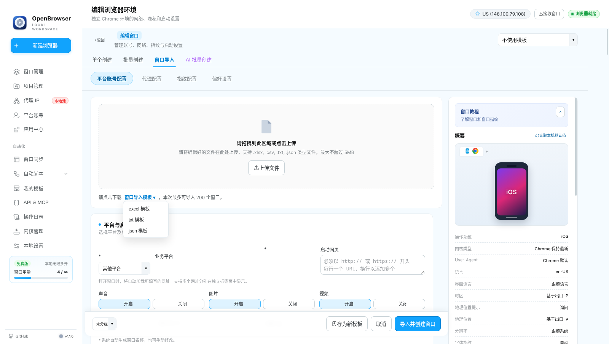
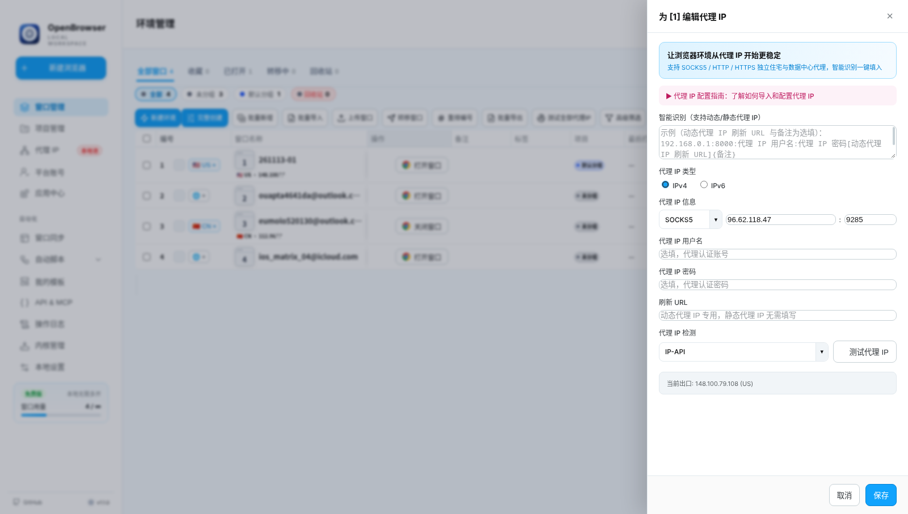
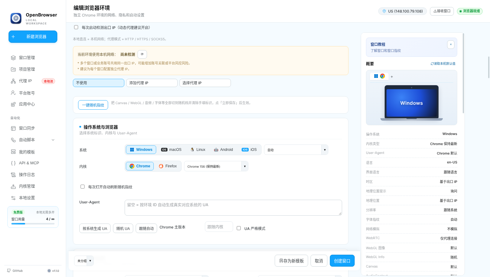
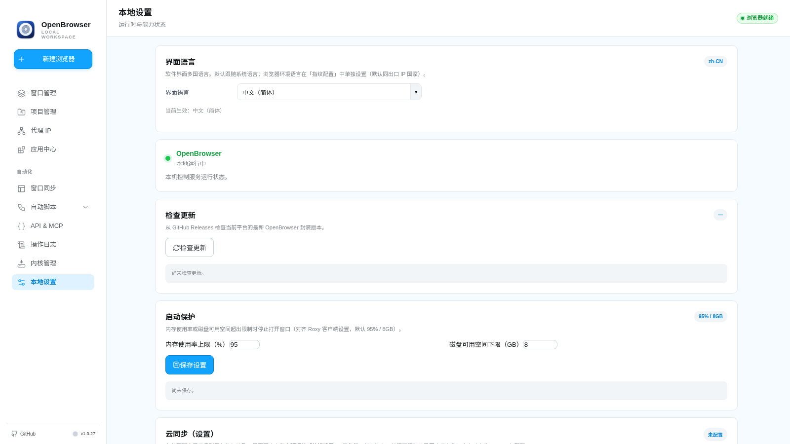

<div align="center">


[](https://github.com/zhu748/OpenBrowser)
[](https://github.com/zhu748/OpenBrowser)
[](./LICENSE)
[](https://nodejs.org/)

**多国语言支持 / Multi-language support**

🇺🇸 [English](./README.md) · 🇨🇳 **中文**

**本地指纹浏览器 · 隔离 Chromium 环境 · 代理 / 指纹 / 同步 / RPA**

</div>

---

## 简介

OpenBrowser 是一款本地桌面指纹浏览器，用于管理多套互相隔离的 Chromium 环境。它把 Profile 隔离、代理配置、浏览器指纹参数、扩展管理、窗口同步、本地 API、MCP 集成和本地 RPA 流程集中在一个桌面应用里。

应用支持多国语言界面，目前包含英文和中文。

> 使用前请阅读 [免责声明](./DISCLAIMER.md)。OpenBrowser 不保证匿名、指纹唯一或对特定网站的兼容性。

## 目录

- [界面预览](#界面预览)
- [核心功能](#核心功能)
- [支持平台](#支持平台)
- [快速开始](#快速开始)
- [打包](#打包)
- [自测](#自测)
- [项目结构](#项目结构)
- [数据与安全](#数据与安全)

## 界面预览

| 主界面 | 环境管理 |
| :---: | :---: |
|  |  |
| 主导航与模块入口 | Profile 列表、启停控制、分组 |

| 环境 / 指纹编辑 | 本地设置 |
| :---: | :---: |
|  |  |
| 代理、指纹、扩展设置 | 主题、语言、系统选项 |

## 核心功能

| 模块 | 能力 |
| --- | --- |
| **环境隔离** | 独立 Chromium Profile，Cookie / 缓存 / 存储互不混用。 |
| **批量管理** | 分组、标签、批量启停、日志和窗口尺寸管理。 |
| **代理支持** | HTTP / HTTPS / SOCKS 代理，按环境绑定，支持出口检测。 |
| **指纹参数** | 平台、语言、时区、UA、Canvas、WebGL、WebRTC 等参数。 |
| **扩展中心** | 内置 / 推荐 / 本地扩展，按环境加载。 |
| **窗口同步** | 基于 CDP 同步点击、滚动、输入和标签页。 |
| **本地 RPA** | 打开页面、等待、点击、输入、截图等流程任务。 |
| **Local API / MCP** | 默认本地集成端点为 `127.0.0.1:50325`。 |
| **独立内核** | 可下载独立 Chromium 内核，也可指定本地路径。 |
| **多版本内核** | 与主流指纹浏览器一致，每个大版本只提供一份内核：Chrome for Testing 每个大版本（145/146/147…）取最新构建（`kernels/chromium-versions/<版本>`）；官方 Firefox 各代直接下载（`kernels/firefox/<版本>`，tarball / DMG / MSI 按平台，SHA-256 以 Mozilla SHA256SUMS 为准校验）。已安装版本可一键设为全局默认内核。 |
| **Firefox 内核** | 每个环境可单独选择 Chromium 或 Firefox。Firefox 环境通过 `user.js` 预置 UA / 语言 / 代理 / 遥测关闭等配置，无需 CDP。RPA 与窗口同步按设计仅支持 Chromium 环境。 |
| **扩展程序** | 与主流指纹浏览器一致，可直接在浏览器内安装扩展（Chrome 应用商店“添加至 Chrome”、Firefox 附加组件页面），安装结果保存在环境里、重启后依然生效（启动无任何阻断开关；profile 预备对 `Preferences` 采用读-改-写合并而非覆盖；数据保留与缓存清理从不触碰 `Default/Extensions`）。应用中心提供批量安装（自带应用、商店一键导入、本地目录）与按环境启停（`--load-extension`）。 |
| **备份选项** | 本地、WebDAV、GitHub、网盘备份，仅在主动配置后启用。 |

## 支持平台

| 平台 | 架构 | 状态 |
| --- | --- | --- |
| Windows | x86_64 | ✅ 支持 |
| macOS | x86_64 | ✅ 支持 |
| macOS | arm64 | ✅ 支持 |
| Ubuntu | x86_64 | ✅ 支持 |

## 快速开始

需要 Node.js LTS 和 npm。

```bash
cd Browserapp
npm ci --include=dev
npm run selftest -- environment   # 快速冒烟（运行单个注册测试）
npm start
```

也可以从仓库根目录使用启动脚本：

| 平台 | 启动脚本 |
| --- | --- |
| macOS | [`start-test.command`](./start-test.command) |
| Windows | [`start-test.cmd`](./start-test.cmd) |
| Ubuntu | [`start-test.sh`](./start-test.sh) |

## 打包

```bash
cd Browserapp
# 可选：OPENBROWSER_PACKAGE_ARCH=x86_64 或 arm64
npm run build:rustcore
npm run package:portable
```

构建产物输出到 `Browserapp/dist/`。

| 平台 | 产物说明 |
| --- | --- |
| Windows | 包含 `START.cmd`。 |
| macOS | 包含 `OpenBrowser.app` 和 `启动.command`。 |
| Ubuntu x86_64 | 包含 `OpenBrowser-…tar.gz` 便携包和启动器。 |

安装包不内置浏览器内核，安装后在程序内下载独立的 Chrome Stable 内核。请用普通桌面用户运行 Linux 程序，不要使用 `sudo`。如缺少依赖，可安装标准 Electron/Chromium 桌面库：

```bash
sudo apt-get install libatk-bridge2.0-0 libatk1.0-0 libatspi2.0-0 libcups2 libdrm2 libgbm1 libglib2.0-0 libgtk-3-0 libnspr4 libnss3 libxcomposite1 libxdamage1 libxfixes3 libxkbcommon0 libxrandr2
```

## 自测

`Browserapp/scripts/selftest-all.js` 中的 SUITE 注册表是唯一测试清单；
`npm run selftest -- <name>` 按注册名（或文件名唯一前缀）解析并运行单个测试。

```bash
cd Browserapp
npm run selftest -- list     # 列出全部已注册测试
npm run selftest -- cloud    # 运行单个测试（注册名 / 文件名唯一前缀）
npm run selftest:all         # 聚合运行全部内核无关自测（CI 冒烟入口）
```

需要真实 Chromium/内核的测试不在注册表内，仍保留各自的 npm 脚本，例如：

```bash
npm run selftest:protocol
npm run selftest:kernel
```

## 项目结构

```text
OpenBrowser/
├── Browserapp/            # 应用源码
├── docs/screenshots/      # 截图
├── start-test.command     # macOS 启动脚本
├── start-test.cmd         # Windows 启动脚本
├── start-test.sh          # Ubuntu 启动脚本
├── DISCLAIMER.md
├── LICENSE
├── README.md              # 英文说明
└── README_CN.md           # 中文说明
```

仓库只保留源码与文档，不使用 Git LFS，不跟踪浏览器二进制，也不在安装包内预装内核。普通 `git clone` 即可获取完整源码。首次使用时，程序会按需下载独立的官方 Chrome Stable 内核，也可选择用户自己的浏览器。下载的内核、Profile、Cookie、代理凭据均保留在本地，不进入 Git。

## 数据与安全

- 本地 API 默认只监听回环地址。
- 设置 `OPENBROWSER_API_KEY` 后，请求必须携带 `api-key` 头。
- 浏览器启动失败会追加写入用户 OpenBrowser 数据目录下的本地 `browser-startup.log`。在 `Browserapp/` 执行 `npm run log:startup` 可直接读取；日志已被 Git 忽略。
- 第三方组件声明见 [`THIRD-PARTY-NOTICES.md`](./Browserapp/THIRD-PARTY-NOTICES.md)。
- 云备份集成只有在用户显式配置后才会主动联网。
- **包含账号凭据（Cookie / 密码 / 2FA / 代理登录信息 / 浏览器数据）的备份必须设置备份口令加密后才会上传**，未加密的凭据上传会被直接拒绝。
- 应用内更新器从 `zhu748/OpenBrowser` 下载并核对安装包 SHA-256，同时验证 `SHA256SUMS.txt.sig` 的 Ed25519 签名。所有更新（包括历史版本）都必须通过签名和安装包哈希校验，缺失或失败时拒绝运行安装器，环境变量不能绕过验签。
- 发布签名使用 GitHub 加密 Secret，仅在最终签名步骤暴露。旧版 1.0.0 请先手动覆盖安装本次重发版本，以接入新的签名公钥；后续签名更新使用新信任根。
- RPA 计划、变量与执行结果也加密保存；旧 JSON 文件在成功读取后自动迁移。请通过应用导入/导出，避免直接编辑存储文件。
- 平台账号池和窗口转移记录保存在主进程加密文件中；旧 localStorage 数据只在加密保存确认后清理。账号列表不预载密码和 2FA，显示或使用时按需读取。
- 账号 CSV 支持引号、逗号、换行及公式前缀保护；应用导出的编码标记用于精确保留密码。CSV 和离线转移码本身仍是明文，导出凭据前会明确确认；需要加密迁移时使用云备份导出。
- Cookie 机器人创建可查询、可取消的真实 RPA 任务。无头模式和不加载图片需要先停止环境；任务选项不改写已保存配置，自动关闭也覆盖失败路径。视频选项拦截常见视频资源 URL。
- 创建和接收窗口只在引擎持久化确认后更新界面；批量代理保留失败项供重试。回收站清空按 200 项分批执行，云任务完成只更新任务状态，不覆盖同时编辑的云配置。
- 离线转移的接收方仅作备注，没有服务端身份校验或远程撤回；删除本机记录不会使已分享的转移码失效。多窗口分享按包保存一条加密记录，避免重复保存整包数据。
- 密钥文件无法读取或可靠保存时拒绝写入凭据，防止重启后无法恢复。请保留原密钥和数据文件进行恢复。
- SQLite 迁移备份会加密保存，已有的明文迁移备份也会自动加密；已有数据库无法打开时拒绝切换到空存储。后台加密迁移不会覆盖后续修改或恢复已删除记录。
- Linux 缺少系统密钥库时，使用本地主密钥 AES-GCM 加密，避免采用 `basic_text` 弱保护后端；旧数据仍可读取。
- 分组、标签、备注和编号修改按环境 ID 与修订号提交。超过 200 项的操作分批确认；后续批次失败时保留已确认结果，并提示已完成数量。
- GitHub 备份支持覆盖已有文件和读取超过 1 MiB 的备份；读取元数据失败时不会开始覆盖上传。
- RPA CSV/文本/JSON 导入最多 32 MiB、100,000 行；CSV 最多 1,000 列，CSV 字段和文本行最多 1,048,576 个 UTF-16 码元。超限文件请拆分。
- RPA 按任务所属环境串行，跨环境共用 8 个执行槽；等待任务可取消，且不会占用执行槽。
- 浏览器数据恢复中断后，会阻止该环境启动、删除数据及缓存清理，并保留恢复目录供检查；已完成恢复的暂存残留会在下次启动时清理。

## 文档

- [调度、状态响应与恢复中断保护优化](./docs/dev-reports/2026-11-11-queue-status-recovery-optimization.md)
- [安全、执行与恢复优化](./docs/dev-reports/2026-11-11-security-runtime-optimization.md)
- [代码分类与维护入口](./docs/code-organization.md)
- [项目复审与优化记录](./docs/dev-reports/2026-11-10-project-review.md)
- [会话查询、事务与哈希优化](./docs/dev-reports/2026-11-10-next-optimization.md)
- [性能与可维护性审查](./docs/dev-reports/2026-11-10-performance-maintainability-review.md)
- [第二轮持久化与模块优化](./docs/dev-reports/2026-11-10-round2-persistence-and-modules.md)
- [第三轮 RPA 生命周期与容量优化](./docs/dev-reports/2026-11-10-round3-rpa-lifecycle-and-budget.md)
- [自动化模块](./Browserapp/automation/README.md)
- [免责声明](./DISCLAIMER.md)
- [第三方组件声明](./Browserapp/THIRD-PARTY-NOTICES.md)

---

<details>
<summary>第三方内核来源</summary>

<br>

独立内核来自 [Donut Browser](https://github.com/zhom/donutbrowser) / [Wayfern](https://wayfern.com/)（作者 [zhom](https://github.com/zhom)）。更新源：[wayfern.json](https://donutbrowser.com/wayfern.json)。条款：[Wayfern ToS](https://wayfern.com/tos)。

安装包只包含桌面程序和 Rust 核心；浏览器内核在安装后下载，不依赖内核种子归档或 Git LFS。

</details>

## 许可证

[MIT](./LICENSE)

---

<div align="center">

如果 OpenBrowser 对你有用，欢迎 Star ⭐

</div>
