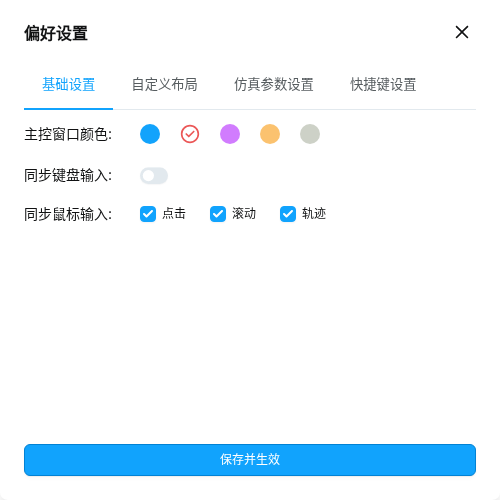
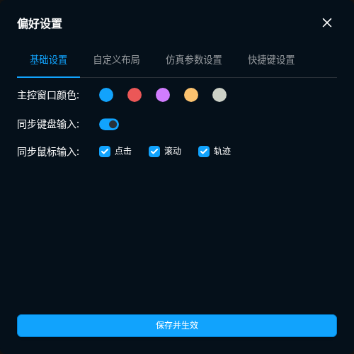

# 第二阶段：原同步弹窗、文件导入与本地缓存

本阶段补功能并保留原页面渲染组件；**没有宣布全项目一比一验收完成**。原主工作台继续是默认入口，原 BrowserEngine/存储/网络/自动化后端继续使用。

## 本次完成

| 能力 | 实现与真实验收 |
| --- | --- |
| 四个同步弹窗 | 使用原 preferences、batch-inputs、open-sites、syncing-window-list 组件，恢复独立无边框置顶窗口；原初始内容区分别 500×500、450×374、450×350、480×350，原组件仍可请求调整尺寸。 |
| 基础/仿真设置 | 原开关和表单保存到本地，并改变原控制器；串行延迟逐从控执行，暂停/代次变化会取消后续目标。 |
| 自定义布局 | 原表单真实设置两台 Chrome 为 640×480、间距 12；实际 CDP 读回两套窗口边界。 |
| 批量输入 | 相同文本、差异文本、随机整数/小数；append=false 先清空。差异文本用实际 PID 映射，非法 PID 不写入。真实双 Chrome 验证替换、追加和差异文本，无重复或延迟清空。 |
| 打开网址 | 活跃同步只命令主控，由原控制器镜像；暂停时逐窗提交。两台真实 Chrome 每个网址恰好一次；替换当前页保留首标签并导航实际活动标签。 |
| 快捷键 | 原快捷键页接 Electron 注册/冲突检查，失败不保存；只释放自有注册，退出等待队列。Linux 按原前端的非 Win/mac 分支取值。系统物理按键的跨平台验收仍未完成。 |
| 深色子窗 | 根组件初始化原主题 Store，独立弹窗继承深色，并通过原 BroadcastChannel 跟随主窗切换。 |
| TXT/XLSX 导入 | 原上传、解析、预览、创建页面；原生选择在主进程读取不超过 5 MiB 的文件，前端仍无 fetch。真实 TXT 和 XLSX 创建三条原后端记录，代理认证、账号 URL/密码、Cookie 和明确内核版本保留。 |
| 导入失败处理 | 分析不写窗口，创建前整批校验，1–200 条；非法 JSON 显示原错误区，不退化为空账号。结尾分隔符不产生空行；混合 OS 的指纹按各行 OS/系统版本/内核分组。 |
| 两种本地缓存清理 | 原右键弹窗；物理移除云端选项及 SDK 调用。复用原缓存、维护锁及路径校验函数；partial 保留插件数据，all 额外清理插件本地目录，两者都保留 Cookie 和登录数据。真实磁盘与原 UI 均验证。 |
| 截图发现的缺失文字 | 未分组行恢复原“默认项目”翻译，原弹层编号补本地 OpenBrowser 前缀；不修改后端分组。 |
| 未接线入口的可见失败 | 原 Toast 显示“未执行”；Cookie Robot 等待请求并保留原表单、输入，实际任务为零；不把兼容层当成已实现。 |
| 故障退出 | Agent 检查点保存拒绝也继续停止实际浏览器，真实 Chrome PID 已消失，诊断日志保留原错误。 |

## 截图

原组件直接渲染，下面是实际窗口/页面截图；尚没有把所有原始页面统一尺寸与数据后完成逐像素差分。

[仿真参数](evidence/sync-preferences-simulate.png) · [自定义布局](evidence/sync-custom-layout.png) · [同步窗口列表](evidence/sync-window-list.png) · [差异文本](evidence/sync-batch-different.png) · [打开网址](evidence/sync-open-sites.png)

[TXT 预览](evidence/import-txt-preview.png) · [实际新增记录](evidence/import-created.png) · [非法输入错误区](evidence/import-invalid.png) · [本地缓存弹窗](evidence/cache-local-dialog.png) · [未接 Cookie Robot 的明确错误](evidence/cookie-robot-unavailable.png)

## 接口契约与限制

- `ui:dialog:open/close/show/resize`：只允许四个类型；来源必须是登记过的主窗/子窗和精确 index 文档，子窗关闭/调整自身窗口。未知类型、原型属性名、其他文档和未登记窗口全部拒绝。
- `sync:batch-text`：`{mode,data,append}`。same 的 data 为文本；diff 为 `{实际进程PID:文本}`；random 为 `{min,max,data_type,decimal_place_count}`。文本上限 100000 字符；随机范围 ±1e9、精度 1–10；批次 1–200 个活跃 CDP 窗口。
- `sync:open-sites`：`{urls,replaceCurrentTab}`，1–50 个 HTTP(S) 或 about:blank；先验证全部地址再操作。活动会话返回主控提交计数，镜像由原控制器完成，测试另行检查所有从控的实际结果。
- `sync:layout`：grid/stack 使用原布局方法；custom 接 `{w,h,gap_horizontal,gap_vertical,count_per_row}`，使用原 CDP 边界接口。
- `profiles:analyse-import/import/choose-import`：分析、创建和原生选择分开；JSON DTO 的完整记录边界在主进程再次校验，明确的逐行版本优先于全局 latest。
- `profiles:clear-cache`：`{dirIds,clearType:'partial'|'all'}`。整批先检查存在性、忙状态、维护/恢复锁和根目录；具体目录删除仍由原后端安全文件函数执行，文件系统错误明确返回。

**标准 Chrome 不支持 Roxy 的 `Browser.setColor`。** 现在选择其他主控颜色会收到明确错误，弹窗及原设置保留；没有把保存成功当作内核真的改色。[真实失败状态截图](evidence/sync-color-unsupported.png)。支持此私有命令的内核路径未验收。

原 Cookie Robot 已继续逆向：Roxy 会滚动到底部并有 Firefox BiDi 路径，而现有 OpenBrowser warmup 是每个 URL 一个滚动步骤且只支持 Chromium，不能用简单改名冒充完整迁移；仍列未完成。

## 验证边界

证据：[同步原弹窗](evidence/sync-dialogs-ui-selftest.json)、[控制器与参数](evidence/sync-service-selftest.json)、[子窗安全/主题](evidence/dialog-security-selftest.json)、[导入服务](evidence/import-selftest.json)、[导入 UI](evidence/import-ui-selftest.json)、[缓存服务](evidence/profile-cache-selftest.json)、[缓存 UI](evidence/profile-cache-ui-selftest.json)、[退出失败](evidence/quit-failure-selftest.json)、[未接线可见失败](evidence/unavailable-ui-selftest.json)。

测试运行真实 Electron 和独立 Chrome；文件选择仅固定原生对话框的返回路径，确实读取磁盘并使用原解析器。无显示服务器的子窗测试用实际原生内容区尺寸设置视口，原生尺寸仍有独立断言。串/并行时序单元测试隔离 CDP 传输，真实控制器逻辑不替换；浏览器效果另由真实双进程端到端测试检查。退出测试明确注入持久化拒绝，随后检查实际进程和实际诊断文件。

所有页面、弹层、主题和状态的像素对照仍未穷尽；Windows/macOS/DPI/多屏、全局按键与安装包未验证。详细未完成项见 [BLOCKERS.md](BLOCKERS.md)。
